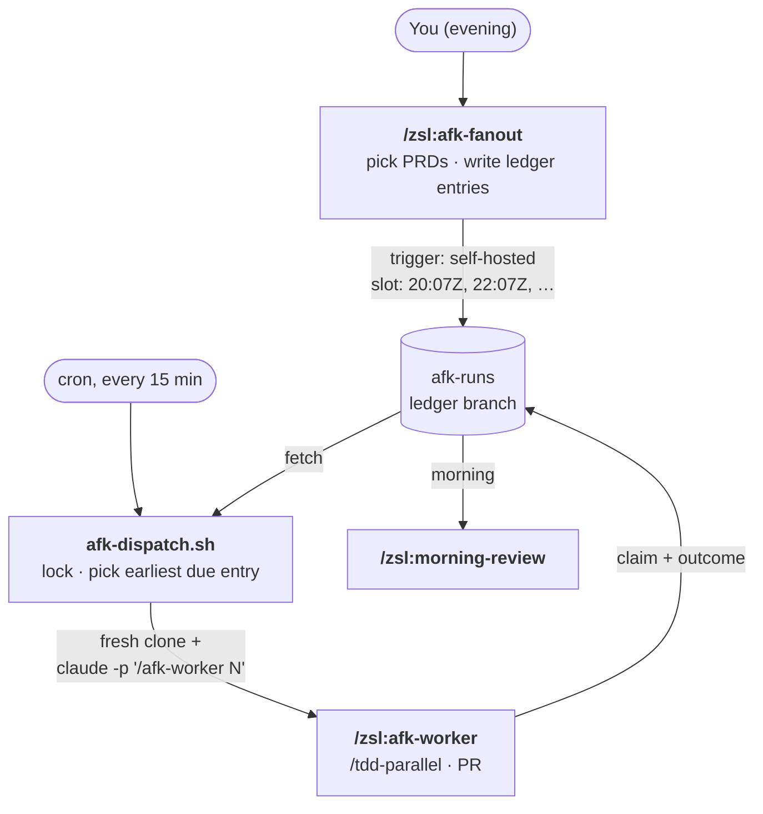

# Self-hosted runner (any model, e.g. MiniMax)

The [overnight loop](remote-agents.md) normally runs each worker as a
one-off **claude.ai routine**: an Anthropic-hosted session, Claude models
only. The **self-hosted runner** replaces just that part. A machine you own
runs a small dispatcher from cron, and each worker becomes a headless
Claude Code session on that machine. Claude Code can point at any
Anthropic-compatible endpoint, so the model can be
[MiniMax](https://platform.minimax.io/docs/token-plan/claude-code) (or Claude
via an API key).

The rest of the loop doesn't change: `/zsl:afk-fanout` in the evening, the
`afk-runs` ledger branch, `/zsl:afk-worker` → `/zsl:tdd-parallel`, and
`/zsl:morning-review` in the morning.

## How it works



- **The ledger is the queue.** Nothing gets scheduled per job. `/afk-fanout`
  writes each PRD's entry with `trigger: self-hosted` and a UTC `slot`. Every
  tick, the dispatcher picks the earliest entry that is `claim: scheduled`,
  `outcome: pending`, and past its slot.
- **One worker at a time.** A lock means a tick that finds a worker still
  running exits and waits for the next tick. That's what makes a small
  machine enough.
- **Never re-run.** An entry is recorded as dispatched *before* its worker
  starts, so a worker that crashes before claiming is reported (Telegram)
  instead of retried every 15 minutes.
- **Stuck runs are kept.** If a worker leaves its claim `in-progress` (a 3e
  merge-conflict halt), its clone is marked `.afk-keep` and never pruned.
  Other clones are deleted after `AFK_KEEP_DAYS`.

The selection rule is a [deterministic gate](https://github.com/ZunoSmartLabs/zsl-superpowers/blob/main/skills/remote-agents/afk-worker/scripts/select-due-entry.sh)
with its own tests.

## The machine

The model runs at the provider, so the machine only runs Claude Code
(Node.js), git, and **your project's tests**. Your tests decide the size:

| Your tests | RAM | CPU | Disk |
|---|---|---|---|
| Light: unit tests, no Docker | **4 GB** | 2 vCPU | 50 GB SSD |
| Medium: one database container | **8 GB** | 2–4 vCPU | 50–100 GB SSD |
| Heavy: several containers, browser tests, big compiles | 16 GB | 4+ vCPU | 100 GB SSD |

No GPU. Add 4–8 GB of swap as a safety net. Keep `AFK_MAX=1` (one TDD
sub-agent at a time) on 4–8 GB machines. Linux (Ubuntu LTS) or macOS.

Overnight, workers run with **no permission prompts** and hold a GitHub token
and your model API key. Use a dedicated machine or VM (not your daily
laptop), a separate OS user, and a fine-grained GitHub token limited to the
target repos.

## Setup

`/zsl:setup-zsl-superpowers` Section F (choose `self-hosted`) walks you
through these steps. By hand:

**1. Install the tools.** Node 18+, [Claude Code](https://docs.claude.com/en/docs/claude-code),
`git`, `gh`, `jq`, `curl`, plus whatever your project's `make test` needs.

**2. Check out zsl-superpowers.** The dispatcher and the skills-provisioning
hook both live in it:

```bash
git clone https://github.com/ZunoSmartLabs/zsl-superpowers ~/zsl-superpowers
```

**3. Write the env file** at `~/.config/zsl-afk/env` (then `chmod 600`):

```bash
# Model — MiniMax via its Anthropic-compatible endpoint.
# (China region: https://api.minimaxi.com/anthropic.) For Claude via API key,
# drop these five lines and set ANTHROPIC_API_KEY instead.
ANTHROPIC_BASE_URL=https://api.minimax.io/anthropic
ANTHROPIC_AUTH_TOKEN=<minimax api key>
ANTHROPIC_MODEL=MiniMax-M3
ANTHROPIC_DEFAULT_OPUS_MODEL=MiniMax-M3      # skills pinned to `model: opus`
ANTHROPIC_DEFAULT_SONNET_MODEL=MiniMax-M3
ANTHROPIC_DEFAULT_HAIKU_MODEL=MiniMax-M3

# GitHub — clone, push branches, open PRs, push the afk-runs ledger.
GH_TOKEN=<fine-grained PAT: contents + pull requests on the target repos>

# Runner
AFK_REPOS="https://github.com/<owner>/<repo>"   # space-separated, several allowed
AFK_MAX=1                    # /tdd-parallel --max (sub-agents per wave)
# AFK_WORK_DIR=~/afk/work    AFK_LOG_DIR=~/afk/logs    AFK_STATE_DIR=~/afk/state
# AFK_KEEP_DAYS=7            AFK_TIMEOUT_HOURS=6
# ZSL_SUPERPOWERS_REF=main   # skills version the provisioning hook checks out

# Optional Telegram heads-up (see Section F4 of setup)
# AFK_TELEGRAM_BOT_TOKEN=…
# AFK_TELEGRAM_CHAT_ID=…
```

Check MiniMax's [Claude Code guide](https://platform.minimax.io/docs/token-plan/claude-code)
for the current model name. Make sure no `ANTHROPIC_*` exports in your shell
rc files override these values.

**4. Let git push with the token:** `gh auth setup-git` (as the runner user).

**5. Add the cron entry** (`crontab -e`). Cron's `PATH` is minimal, so set
one that includes `claude` and `node`:

```cron
PATH=/usr/local/bin:/usr/bin:/bin:/home/afk/.npm-global/bin
*/15 * * * * $HOME/zsl-superpowers/skills/remote-agents/afk-worker/scripts/afk-dispatch.sh >>$HOME/afk/dispatch.log 2>&1
```

**6. In each target repo**, set `runner: self-hosted` in
`docs/agents/remote-env.md`, along with `slot_spacing_hours` (default 2) and
the runner host name.

**7. Smoke test.** Run `afk-dispatch.sh` once by hand. With nothing scheduled
it should log `nothing due at …`.

## Where to look in the morning

`/zsl:morning-review` works as usual. For a self-hosted run, the ledger
entry's `routine:` field is `<host>:<log path>`: the full worker transcript
is in that file. A stuck run's clone is in `AFK_WORK_DIR`, and the
dispatcher's own tick log is `~/afk/dispatch.log`.

## Model caveat

The worker is a long, unattended, tool-heavy run (sub-agents, worktrees,
merges, a coverage loop), and these skills are tuned on Claude. Before
trusting a night of work to another model, try it interactively: point a
local Claude Code at the same endpoint and run `/zsl:tdd-parallel` on a
small PRD.
